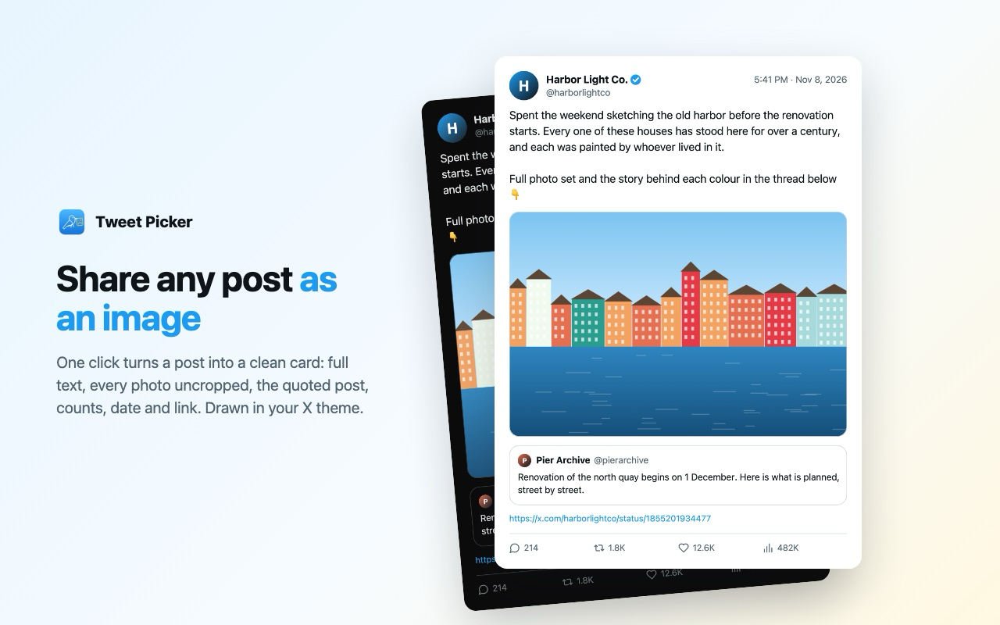
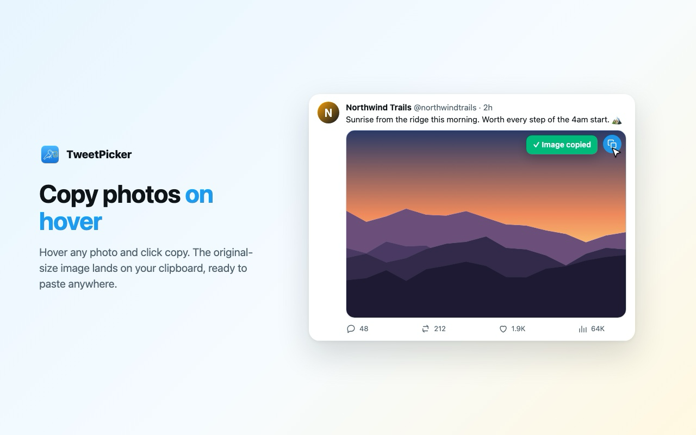
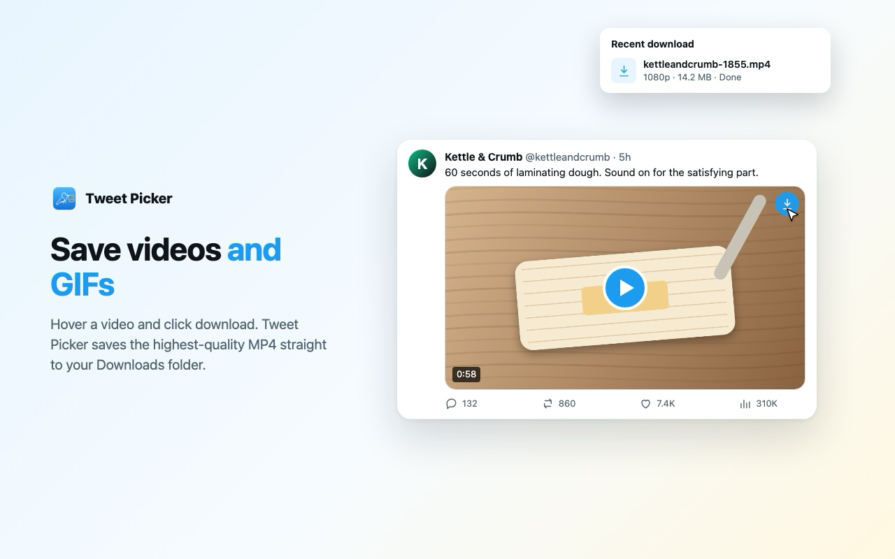
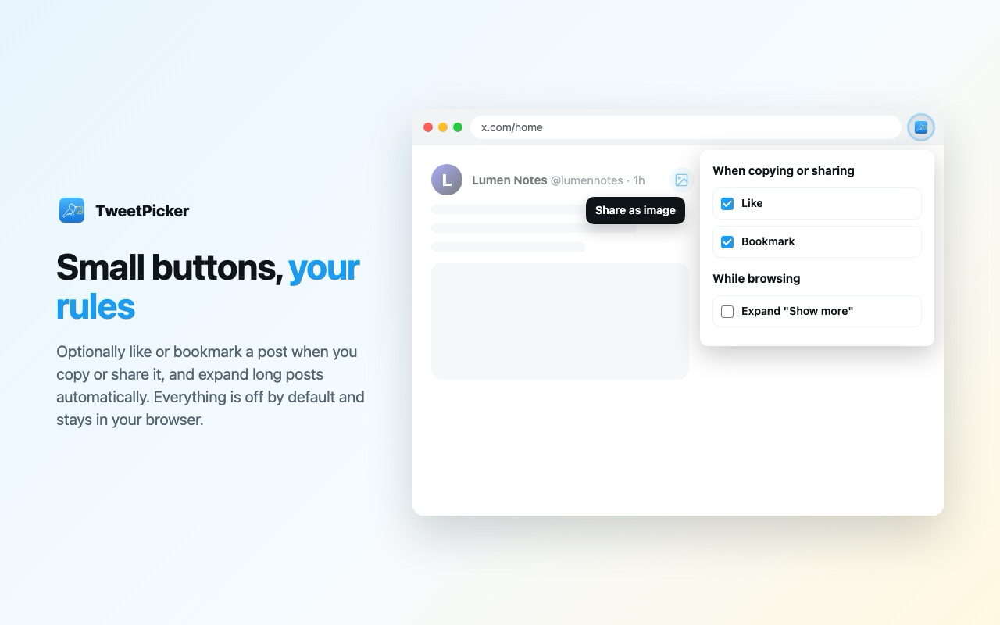

# TweetPicker

A Chrome extension (Manifest V3) for X / Twitter: copy photos, save videos, and share any post as a clean image.

**Website:** [tweetpicker.weierz.com](https://tweetpicker.weierz.com/)

## Features

### Share a post as an image

Hover a post and click the picture icon at the start of its top-right icons (before Grok and `···`). TweetPicker copies a card of the post to your clipboard, drawn in your X theme:

- the full text, with no "Show more" cut-off
- every image, uncropped
- the quoted post, and the link preview with its full URL
- X Articles in full: cover, title, headings, lists and images
- counts, the date, and a footer with the post's `https://x.com/…` link

The page doesn't scroll or flash while the card is made. If you've pressed X's "Show translation", the card uses the translation and notes the original language; nothing is translated on its own.

### Copy photos

Hover a photo, in the timeline or the full-screen viewer, and click the copy button in its top-right corner. The original-size image is copied as a PNG.

### Save videos and GIFs

Hover a video or GIF and click the download button in its top-right corner. The highest-quality MP4 is saved to your Downloads folder.

Every button answers in place: a green check when it worked, a red ✕ when it didn't (hover the ✕ to see why).

## Settings

Click the toolbar icon to open the options. All are off by default.

| Option | What it does |
| --- | --- |
| Like | After a photo copy or post share, like the post using X's own button. |
| Bookmark | The same, for bookmarks. Posts you've already liked or bookmarked are left alone. |
| Expand "Show more" | Open long posts in the timeline as they appear, using X's own button. |

## Install from source

1. Open `chrome://extensions`.
2. Turn on **Developer mode**.
3. Click **Load unpacked** and choose this folder.

Open x.com tabs pick up the extension, and later updates, without a refresh.

## How it works

| File | Role |
| --- | --- |
| `inject.js` | Runs in the page. Reads X's own API responses for each post's full data and video MP4 URLs. For X Articles, which timelines only preview, it loads the full body from X's API (`TweetResultByRestId`) with your signed-in session, as the page does. |
| `card.js` | Draws the share card on a canvas. Without X's data for a post it falls back to the public embed endpoint, then to the visible page. |
| `content.js` | Adds the hover buttons and handles the clipboard. X's selectors live at the top of `decorate()`; update them when X changes its markup. |
| `background.js` | Fetches images cross-origin, starts downloads, and falls back to `cdn.syndication.twimg.com` for video URLs it hasn't seen. |
| `options.html` / `options.js` | The settings popup. |
| `site/` | The landing page and privacy policy; `site/deploy.sh` publishes them. |
| `store/` | Chrome Web Store screenshots (`render.sh` renders `shots.html`). |

## Permissions

| Permission | Why |
| --- | --- |
| `downloads` | Save videos. |
| `clipboardWrite` | Copy images and share cards. |
| `storage` | Remember your settings. |
| `scripting` + x.com / twitter.com | Load a new install or update into tabs that are already open. |
| `*.twimg.com` | Fetch images, video URLs and post data from X's media and embed servers. |

## Privacy

TweetPicker only talks to X's own servers. No account, no analytics, nothing sent anywhere else. See [PRIVACY.md](PRIVACY.md).

## License

Copyright © 2026 Weier Zhang. Licensed under the [GNU Affero General Public License v3.0](LICENSE).

Not affiliated with X Corp.
